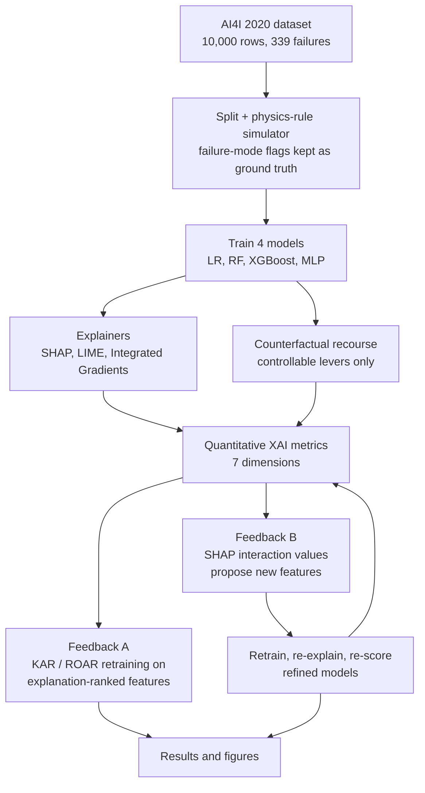

# Predictive-Maintenance
Explainable failure prediction on AI4I 2020: Logistic Regression, Random Forest, XGBoost and MLP explained with SHAP, LIME, Integrated Gradients and counterfactuals, then scored on 7 XAI metrics and fed back to retrain the models.
# Explainable Machine-Failure Prediction on AI4I 2020

**Industrial AI · Predictive maintenance · Explainable AI with quantitative XAI evaluation**

Most XAI work stops at the plots. This project builds four failure-prediction models on the AI4I 2020 Predictive Maintenance dataset, explains them with SHAP, LIME, Integrated Gradients and counterfactuals, and then **feeds every explanation back into the model it explains** to measure whether the explanation is actually any good. The loop is then closed: explanations propose new features, the models are retrained, re-explained and re-scored.

## What is in the notebook

- **Models:** Logistic Regression, Random Forest, XGBoost and an MLP.
- **Explainers (local attributions towards P(failure)):**
  - SHAP: exact interventional Shapley values (all 2⁶ feature coalitions), model-agnostic.
  - LIME: tabular LIME with quartile discretisation.
  - Integrated Gradients: path-integrated central finite differences, averaged over sampled baselines (expected gradients). Also works for tree ensembles.
- **Counterfactual recourse:** searches only over controllable settings (rpm, torque, and tool wear, which can only decrease via a tool change). Product type and temperatures are immutable. Each counterfactual is sparsified by pulling changed features back towards their original values.
- **Physics simulator:** a re-implementation of the published AI4I failure-generation rules. It reproduces the HDF, PWF and OSF labels exactly and is used to check whether acting on an explanation would fix the *machine*, not just change the model's output.
- **Seven XAI dimensions**, each scored by re-querying or retraining the model:

| Dimension | How the explanation is fed back |
|---|---|
| Faithfulness | Remove or keep the top-attributed features and re-query the model; KAR/ROAR retraining |
| Fidelity | Use the explanation as an additive surrogate and compare with the model |
| Stability | Re-run the explainer on the same input with new seeds and background samples |
| Robustness | Re-explain slightly perturbed inputs |
| Consistency | Agreement across explainers, across models and with the true failure physics |
| Actionability | Act on the top controllable levers and re-query the model and the physics simulator |
| Confidence | Top-feature consensus across re-runs, attribution dispersion, coupling with model margin |

Grad-CAM is not used. It needs convolutional feature maps over spatial input, and AI4I has six scalar sensor readings, so Integrated Gradients fills the gradient-based slot.

## Architecture



**Feedback A (KAR / ROAR):** retrain every model keeping only, or removing, the top-k features of each explainer's global ranking. A faithful ranking keeps performance with few features and destroys it when the top features are removed.

**Feedback B (explanation-guided feature engineering):** SHAP interaction values pick the feature pairs the model combines. The operator for each pair is chosen by mutual information, and subtraction is only allowed between features that share a unit. The new features are added inside every model, so inputs and explanations stay in the raw six-feature space.

## Key findings (reference run: seed 42, full budget)

1. **No explainer wins on every dimension.** SHAP has the best overall score: faithfulness ≈ 0.86, fidelity R² ≈ 0.52, ground-truth alignment ≈ 0.82, physics-valid recourse ≈ 0.87 (≈ 0.93 after refinement). LIME is the most stable explainer (re-run Spearman ≈ 0.87) but the least faithful and robust: its fidelity R² is below zero, and its surrogate disagrees with the model on about 24 % of decisions. Stability alone cannot certify an explanation.
2. **Integrated Gradients depends on its baseline.** Its attributions add up to the prediction (MAE ≈ 0.006), but it is the least stable explainer because the result depends on which reference machine is used.
3. **A faithful explanation of a wrong model is still misleading.** Logistic regression has the most faithful explanations but the lowest ground-truth alignment (≈ 0.62, against 0.81 to 0.85 for the tree models). A linear model cannot represent the PWF power band or the HDF AND-rule.
4. **Model-valid recourse is not machine-valid recourse.** 100 % of counterfactuals flip the model, but only about 28 to 49 % would actually stop the failure under the physics rules.
5. **Closing the loop pays off for tree models.** The SHAP-interaction features (rpm × torque ≈ power, air/process temperature ≈ heat dissipation) raise Random Forest PR-AUC from ≈ 0.76 to ≈ 0.84 and XGBoost from ≈ 0.76 to ≈ 0.81. Physics-valid counterfactuals rise from ≈ 0.49 to ≈ 0.73 (RF) and ≈ 0.42 to ≈ 0.69 (XGBoost).
6. **The cost is raw-feature faithfulness.** Faithfulness and fidelity R² drop slightly because refined models rely more on interactions. The MLP and logistic regression did not gain accuracy, so accuracy and explanation quality both have to be measured.
7. **Model confidence does not imply explanation confidence.** Explanation stability is negatively correlated with the model's decision margin: on saturated predictions the attributions are tiny and their ranking is noisy.

### Caveats

- The removal-based metrics favour SHAP because they work the same way it does. An independent background sample reduces but does not remove this bias.
- Dimension scores are relative to this study.
- Single train/validation/test split and a single seed.
- The tool-wear failure (TWF) rule is a proxy (wear ≥ 200 min).
- Numbers above are from the reference run. Different library versions or `FAST = True` move individual numbers slightly, but the pattern should hold.

## Repository layout

```
.
├── README.md
├── requirements.txt
├── .gitignore
└── notebooks/
    └── xai_predictive_maintenance_ai4i.ipynb
```

The notebook is organised as: Setup, Data, Models, Explainers, XAI metrics, Baseline, Feedback A, Feedback B, Results, Interpretation. Outputs and figures are saved in the notebook.

## How to run

1. Open `notebooks/xai_predictive_maintenance_ai4i.ipynb` in Google Colab or Jupyter.
2. Run all cells. The first cells install `shap`, `lime` and `xgboost` and download the dataset from the UCI repository (with a mirror as fallback).
3. Set `FAST = True` in the configuration cell for a quicker, lower-budget run.

Local setup: `pip install -r requirements.txt`

## Data

[AI4I 2020 Predictive Maintenance Dataset](https://archive.ics.uci.edu/dataset/601/ai4i+2020+predictive+maintenance+dataset) (UCI): 10,000 machine records, 339 failures (TWF / HDF / PWF / OSF / RNF = 46 / 115 / 95 / 98 / 19), six input features.
